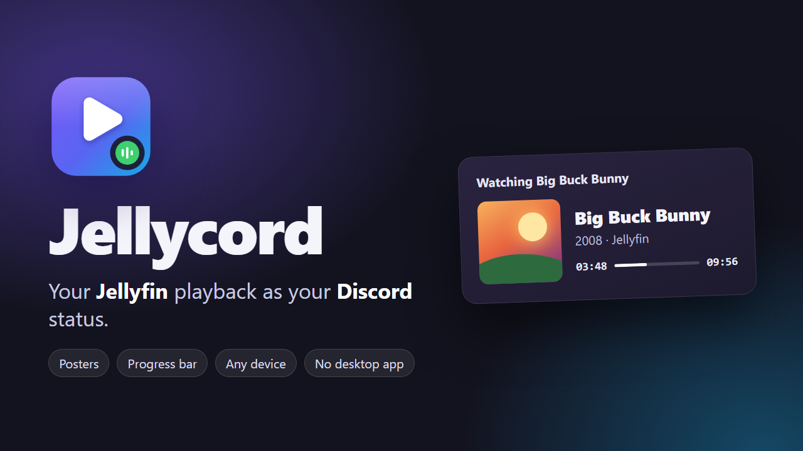
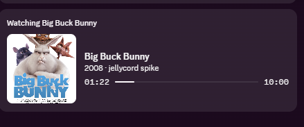
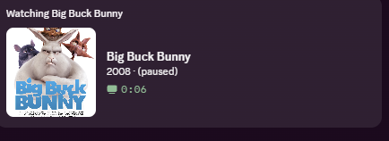

<p align="center"></p>

# Jellycord

A Jellyfin plugin that shows what you're watching as your **Discord status**: "Watching Breaking Bad · S5E14 · Ozymandias", with the poster and a live progress bar. It works for every user on the server who links their Discord, on any device (TV, phone, browser). Nobody needs the Discord desktop app running.

> **Status: early (v0.1, Jellyfin 12.x).** Built against Jellyfin 12.0 / .NET 10, and loads and tracks playback on 12.2. The Discord headless-sessions flow (link, set, pause, delete) was checked against a real Discord app in October 2026. It's an undocumented endpoint, so please report what works and what doesn't.

## Why not a bot token?

A Discord bot can only set **its own** status, and even then only plain text, no poster or progress bar. Discord gives third-party apps no supported way to set a user's status with a bot token, and using your own user token is self-botting, which can get your account banned.

Jellycord uses Discord's **Social SDK presence** instead. Each server admin creates their own (free, self-serve) Discord application, and each user links their Discord account once through OAuth. The server then sets their status via Discord's `headless-sessions` API. See [docs/research.md](docs/research.md) for the full write-up.

## Setup

### 1. Create a Discord application (admin, once)

1. Go to <https://discord.com/developers/applications> → **New Application**. Any name works; the status shows the media title, not the app name.
2. **OAuth2** → turn on **Public Client** → Save. (If you'd rather keep it off, copy the **Client Secret** for step 3.)
3. **Discord Social SDK → Getting Started**: fill in the short form. It's self-serve, with no review.
4. Copy the **Application ID** from *General Information*.

### 2. Install the plugin

Dashboard → **Plugins → Repositories → +** and add:

```
https://raw.githubusercontent.com/hecker-01/jellycord/main/manifest.json
```

Then **Catalog → Jellycord → Install**, and restart Jellyfin.

Manual install: download the zip from [Releases](https://github.com/hecker-01/jellycord/releases), unzip it into `<jellyfin data>/plugins/Jellycord/`, and restart.

### 3. Configure

Dashboard → Plugins → **Jellycord**:

- **Application ID**: from step 1.
- **Public server URL** (optional): set this only if your server is reachable from the internet over HTTPS (`https://jellyfin.example.com`). Discord then loads posters straight from it. Image URLs never include an API key. Leave it empty for LAN, Tailscale or VPN-only servers (see [Posters on private servers](#posters-on-private-servers)).
- **Upload posters as a last resort** (optional, off): see below.
- **Fallback image** (optional): shown when there's no poster. Leave it empty for the Jellycord logo, or use an https image URL, an art asset key from your Discord app, or `none`.
- **Status badge**: a small playing/paused icon on the corner of the artwork (on by default).
- **Private content**: libraries, tags and parental ratings that should never be shown (see [Private content](#private-content-nsfw)).
- Choose what to show (movies / episodes / music), whether to keep the status while paused, and the clear delay.

### 4. Link users

**With the [File Transformation](https://github.com/IAmParadox27/jellyfin-plugin-file-transformation) plugin installed (recommended):** users find **Discord status** in Jellyfin's own user menu (avatar → Discord status) and on the **Settings** page. It opens a native Jellyfin page where they link Discord and set their privacy options. You can turn this off in the plugin settings.

**Without it:** users open **`https://<your-jellyfin>/Jellycord/Link`** while signed in to Jellyfin web. The admin page shows the URL.

Either way they click **Link Discord** and approve the code at `discord.com/activate`. Admins can see and unlink accounts on the plugin settings page.

## What it shows

<p>
  
  
</p>

| Playing | Discord shows |
|---|---|
| Episode | **Watching** *Series* · `S1E2 · Episode title` · series poster · progress bar |
| Movie | **Watching** *Title* · year · poster · progress bar |
| Music | **Listening to** *Track* · `by Artist · Album` · album art |
| Paused | Same, with "Paused" and no progress bar (or cleared, if configured). Discord shows its own small elapsed timer here. |

Theme songs, trailers and other extras are ignored. If a user plays on several devices at once, the one actually playing wins.

### Private content (NSFW)

Some things shouldn't end up on your Discord profile. A private item only shows **"Watching *Your Server Name*"**, with the Jellycord logo: no title, poster, progress bar or pause state, and no poster lookup or upload happens for it.

An item is private if any of these match:

- **Admin rules** (plugin settings, apply to everyone): private libraries, tags (default `nsfw, adult, xxx, hentai, porn`, including tags on the series or album) and parental ratings (default `XXX, X, AO, NC-17, R18, R18+, 18+`).
- **User rules** (each user's link page): users can mark extra libraries or tags private for themselves, or turn on **Keep everything private** to only ever show the server name. Users can add rules but can't remove the admin's.

`GET /Jellycord/Preview/{itemId}` reports `isPrivate` under the admin rules.

### Posters on private servers

Discord fetches images from the internet, so it can't load posters from a server behind Tailscale, a VPN or your LAN. Jellycord works around this without exposing your server:

1. **Original source (automatic).** Jellycord asks your server's own metadata providers (TMDB, MusicBrainz/Cover Art Archive, TheAudioDB, etc.) for the item's poster and hands Discord that public URL. This uses the providers and keys Jellyfin already has, so there's nothing to configure. It covers anything Jellyfin matched online: movies, shows (series poster) and most music.
2. **Temporary upload (opt-in).** For items with no online match (home videos, unmatched files), you can let Jellycord upload the local poster to [Litterbox](https://litterbox.catbox.moe), which deletes it after 72 hours. This publishes that artwork to a third party, so it's off by default.
3. **Fallback.** Otherwise the Jellycord logo is shown (or your own fallback image).

Results are cached per item. To check what Discord would get for an item, call `GET /Jellycord/Preview/{itemId}` as an admin. It returns the activity JSON and which image source was used.

Avoid exposing the whole server with Tailscale Funnel just for posters. Option 1 covers almost everything without opening anything up.

## Privacy and caveats

- **The Discord permission is broader than presence.** Discord has no presence-only scope; `sdk.social_layer_presence` also grants access to the user's friends list. Jellycord only sets the status. The link page tells users this, and they can revoke access any time under *Discord → Settings → Authorized Apps*.
- Tokens are stored in `<jellyfin data>/plugins/configurations/Jellyfin.Plugin.Jellycord.credentials.json` (owner-only on Linux), outside the plugin configuration, so they're never sent to a browser.
- `headless-sessions` is not in Discord's public docs. Discord could change or gate it. Jellycord delivers presence through a swappable "sink", so a desktop-companion (local RPC) fallback can be added without a rewrite.
- Only approve link codes you generated yourself.

## Development

Requires the .NET 10 SDK.

```bash
dotnet test
```

```bash
dotnet publish src/Jellyfin.Plugin.Jellycord -c Release -o out
```

To check the Discord API against your own app before installing the plugin, run the spike:

```bash
dotnet run --project spike/HeadlessSpike -- --client-id <your application id>
```

It walks through linking, sets a test "Watching Big Buck Bunny" status, tries a paused update, then deletes the session.

### Layout

```
src/Jellyfin.Plugin.Jellycord/
  Playback/   PlaybackTracker (session events → state, 1s decision loop), PresenceDecision (debounce/seek/heartbeat rules)
  Presence/   PresenceMapper (item → activity), IPresenceSink
  Discord/    DiscordClient (OAuth device flow + headless-sessions), HeadlessSessionSink, CredentialStore
  Api/        JellycordController (link page + endpoints)
  Web/        configPage.html (admin), linkPage.html (users), web.js + WebInjection (native jellyfin-web page via File Transformation)
assets/               logo, banner, status icons (SVG sources + PNGs used by Discord and the catalog)
spike/HeadlessSpike/   standalone API check
docs/                  research report and notes
```

### Releasing

Push a tag like `v0.1.0`. The release workflow builds the zip, creates a GitHub release, and adds the version to `manifest.json`.

## Roadmap

- Desktop companion sink (local Discord RPC) as a fallback
- IMDb / TMDB buttons, custom text templates, library allow/deny lists
- Jellyfin 10.11 build

## Credits

The headless-sessions flow follows [mrzeappleGit/jellyfin-plugin-discord-presence](https://github.com/mrzeappleGit/jellyfin-plugin-discord-presence) (MIT), which first documented the endpoint's behaviour.

## License

[GNU General Public License v3.0](LICENSE)
